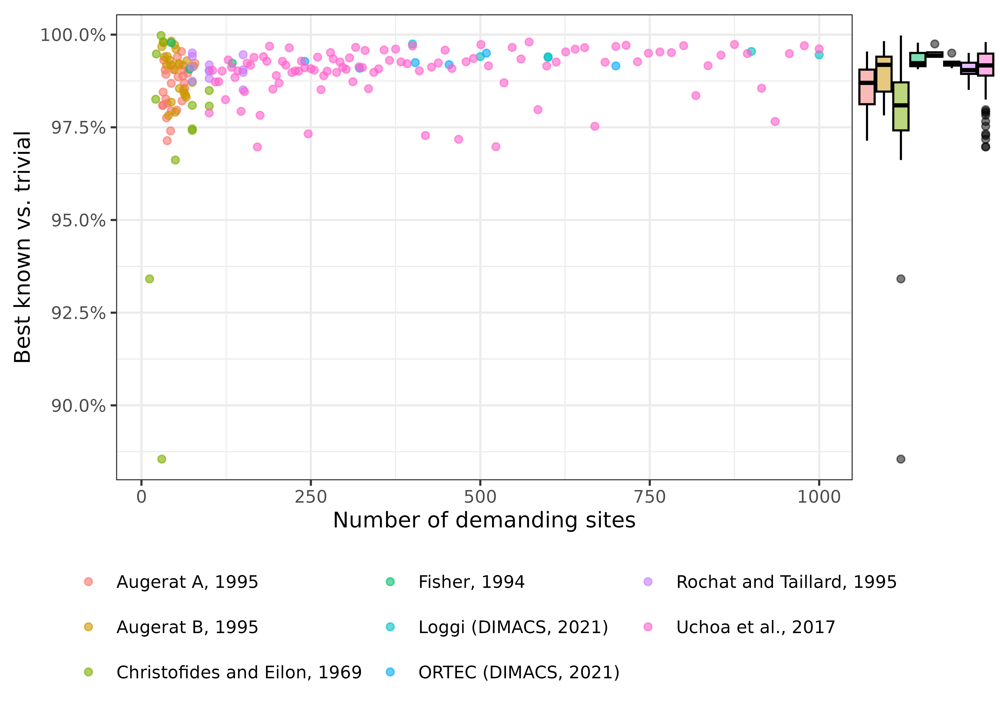
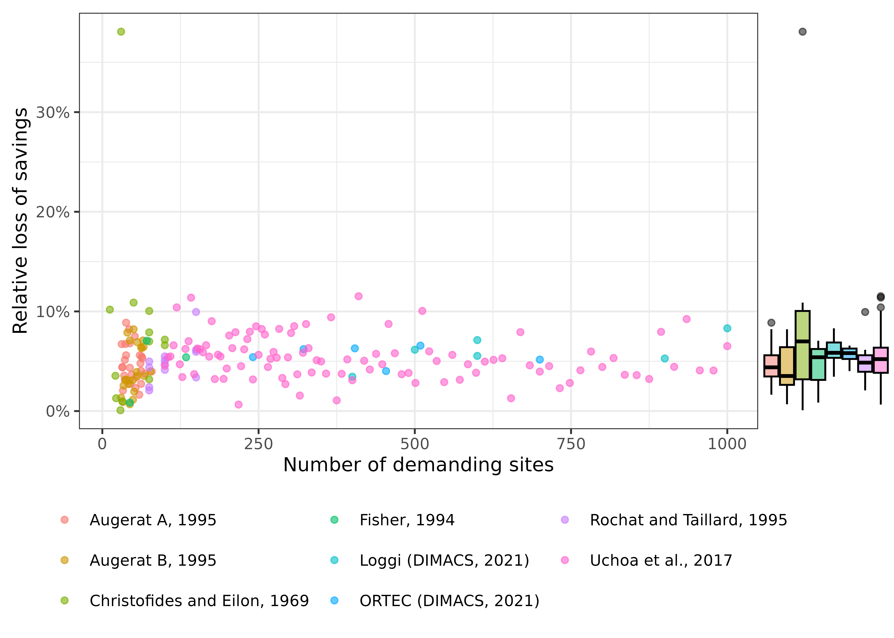
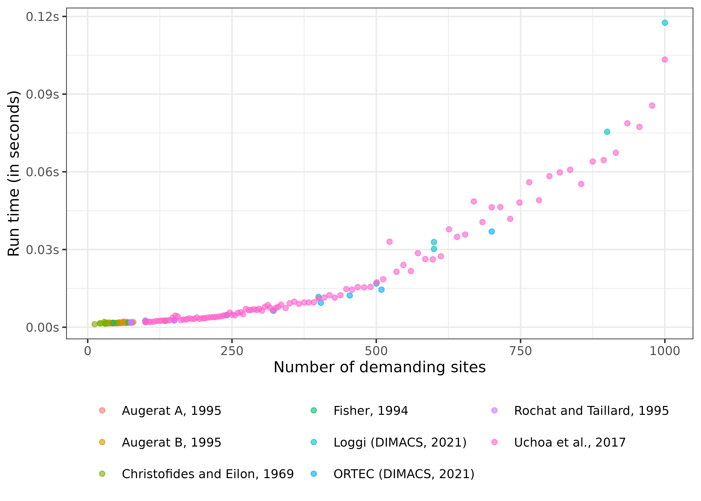

# Clarke Wright Performance Benchmarks

In this vignette we discuss performance benchmarks of the Clarke-Wright
algorithm implemented in this package by comparing the Clarke-Wright
solutions of a set of problem instances with their best known value, and
by measuring the run time on those instances.

### The problem instance data

The problem instances we are basing our measurements on are provided
courtesy of
[CVRPLIB](https://galgos.inf.puc-rio.br/cvrplib/en/instances) and can be
divided into eight groups[^1] of different characteristics:

- Augerat A, 1995 (27 instances)

- Augerat B, 1995 (23 instances)

- Christofides and Eilon, 1969 (13 instances)

- Fisher, 1994 (3 instances)

- Rochat and Taillard, 1995 (12 instances)

- Uchoa et al., 2017 (100 generated instances with 100 to 1000 sites)

- Loggi, DIMACS 2021 (6 instances with 400 to 1000 sites, extracted from
  real problems)

- ORTEC, DIMACS 2021 (6 instances with 241 to 700 sites, derived from
  real problems)

The data provides the problem instance as well as the best known
solution, whose cost is available as the field `best_known_cost` of each
instance. CVRPLIB lists the best known solutions of all instances of the
first five groups as proven optimal, but only for 61 of the 100
instances by Uchoa et al. and for none of the Loggi and ORTEC instances.
For those, a better solution than the best known one might exist.

The data of the first five groups is bundled with this package. The
results for all groups are precomputed, so that building this vignette
does not require downloading anything. See `data-raw/perf.R` in the
[package source](https://github.com/lschneiderbauer/heumilkr) for how
they are obtained.

## Relation to best known and trivial solution

The idea of this indicator is to measure where the Clarke-Wright
solution sits in between the best known solution and the trivial
solution[^2]. Let $`\gamma`$ be the cost of the Clarke-Wright solution,
$`\omega`$ the cost of the best known solution, and $`\alpha`$ the cost
of the trivial solution. The measure $`\xi`$ is defined to be
``` math
\xi := 1 - \frac{\gamma - \omega}{\alpha - \omega}\,.
```
The measure can move between zero and 1. It is zero if the solution is
the trivial solution, and it is one if the solution is the best known
solution.

Evaluating this for CVRPLIB sample data yields the following graph.



The mean value over all problem instances is $`\overline{\xi}=98.9\%`$.

## Relative deviation from best known solution

We can also simply measure the relative deviation of the Clarke-Wright
cost to the best known cost,
``` math
\rho := \frac{\gamma - \omega}{\gamma}\,,
```
which measures how much savings we miss by using the Clarke-Wright
solution instead of the best known solution.



The mean value over all problem instances is $`\overline{\rho}=5.3\%`$,
i.e. on average, we miss out on around $`5.3\%`$ savings taking the
Clarke-Wright solution compared to the best known one. For the instances
derived from real problems (Loggi and ORTEC) it amounts to $`5.8\%`$.

## Run time

The following graph shows the median run time of
[`clarke_wright_cvrplib()`](https://lschneiderbauer.github.io/heumilkr/reference/clarke_wright_cvrplib.md)
for each instance, on an Intel® Xeon® CPU E3-1231 v3 @ 3.40GHz.



The slowest of the instances with 1000 sites takes around $`118`$ ms.

[^1]: The naming is directly taken from
    [CVRPLIB](https://galgos.inf.puc-rio.br/cvrplib/en/instances)

[^2]: By trivial solution we mean the solution where each site is
    assigned exactly one route (which goes back and forth).
